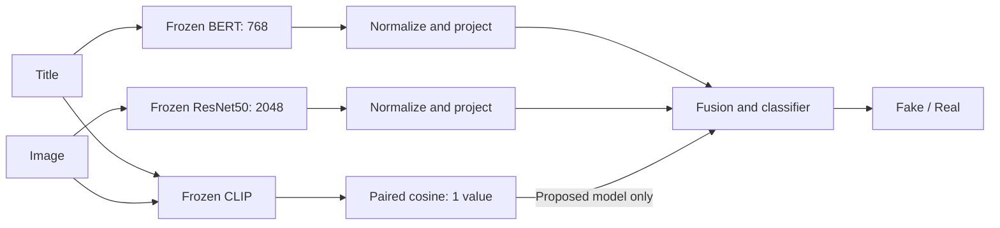

# Multimodal Fake News Detection


This project studies whether image–text correspondence helps a classifier distinguish Fakeddit's fake and real labels. It then examines where that benefit holds, or fails, on an external image–caption benchmark. The encoders are frozen; the original experiment trained small classifier heads on their features.

## Start here

- [Methodology explained](docs/current/methodology.md): inputs, model names, reference margins and evaluation tasks.
- [Results and discussion](docs/current/results_and_discussion.md): the positive Fakeddit result, negative classifier extensions and limited VERITE ranking benefit.
- [Research gap](docs/current/research_gap.md): the empirical question and its claim boundaries.
- [Maintainer guide](docs/current/maintainer_guide.md): code map, source locks and safe commands.
- [Presentation and viva guide](docs/current/presentation_guide.md): a short explanation and questions the team should be able to answer.
- Editorial manuscript: maintained separately for faculty review and not included in this code-only repository.

The original CLIP-scalar model improved Fakeddit performance under the saved protocol. On VERITE, its mean Macro-F1 and AUC increased, but accuracy decreased and the primary transfer comparison remained inconclusive. BRAS did not consistently improve the classifiers. Its symmetric score improved the original true-versus-miscaptioned ranking comparison, but is mathematically half-CSLS under matched references. CCR returned the CLIP-augmented baseline for every seed.

Historical documents record what was known when each stage ran. In particular, early BRAS/CCR reports describe VERITE access as blocked; the later authorized VERITE evaluation supersedes that access status. Those reports are preserved as research records. NewsCLIPpings remains an author-embedding correspondence study; it does not supply another executed frozen-classifier transfer result.

The sections below retain the original Fakeddit setup and measured results. Commands that train, extract features or regenerate reports are reproduction instructions, not steps needed to read or present the completed study.

## Original Fakeddit study

Test whether one paired CLIP cosine-similarity score adds useful information to an otherwise matched BERT + ResNet50 classifier. The primary dataset is **Fakeddit**, using its official multimodal train, validation and public-test resources. Binary labels are **0 = fake, 1 = real**.

The complete primary experiment has run on **50,000 training, 2,500 validation and 2,500 test pairs**. All four models were evaluated across three seeds after validation-only selection. The CLIP-augmented model improved mean Macro-F1; the primary-seed paired bootstrap interval excludes zero. See [the measured results](docs/results_summary.md). The detailed historical worklog is retained outside this code-only repository.

The earlier TruthSeeker investigation is historical only. No TruthSeeker classifier was trained. Its provenance findings remain in `docs/project_worklog.md`; they are not Fakeddit results.

## Dataset and protocol

- Official source: [Fakeddit repository](https://github.com/entitize/Fakeddit) and [dataset paper](https://aclanthology.org/2020.lrec-1.755/).
- Metadata: 564,000 train / 59,342 validation / 59,319 public-test rows. `clean_title` is model text; `image_url` and `id` establish image mapping; `2_way_label` is the target. All labels were checked against the six-way mapping (real iff six-way label 0).
- Image retrieval uses official metadata URLs. Source-verified local image files may be reused; old classifier results and feature caches are not reused.
- Keep official partitions. Reserve normalized text, image URLs and linked-source families to their highest original split (test > validation > train). Within the retained subset, prevent shared source families, text and exact image content. Every exclusion is logged.
- Sample candidates deterministically with seed 20260916 and approximate original binary class proportions. Failed images are excluded with explicit reasons; no blank substitutes or filtering by model performance.
- Fit all feature means and standard deviations using training rows only. Select architecture and checkpoints using validation only. Evaluate test predictions after configuration lock and completion of all prescribed fits.

This is a filtered, availability-dependent subset, not the unfiltered official benchmark. Current image URLs can serve publisher graphics or changed previews; concrete successes and failures were documented in the locally retained error observations, which are not included in this code-only repository. Fakeddit's distant-supervision labels include satire, edited artwork and visual jokes, and are broader than professionally fact-checked news. Exact duplicate checks do not prove that every related event or near-duplicate is absent.

## Models

| Model | Frozen inputs | Learned head |
| --- | --- | --- |
| Text Only | BERT CLS, 768 values | Projection → fusion hidden layer → 2 logits |
| Image Only | ResNet50, 2,048 values | Projection → fusion hidden layer → 2 logits |
| Text + Image | Same BERT + ResNet50 features | Separate equal-size projections → concatenate → fusion → 2 logits |
| Text + Image + Similarity | Same features plus one paired CLIP cosine | Same head with one extra scalar input |

BERT: `google-bert/bert-base-uncased`, revision `86b5e0934494bd15c9632b12f734a8a67f723594`. ResNet50: torchvision `IMAGENET1K_V2`, its associated image transform, final ImageNet layer replaced by Identity. CLIP: `openai/clip-vit-base-patch32`, revision `3d74acf9a28c67741b2f4f2ea7635f0aaf6f0268`, its own processor. Models are frozen and run on CPU in eval/inference mode.

The final 50,000 training titles have BERT token-length median 11, p90 19, p95 23, p99 35 and maximum 71. The selected limit is 64; only three training titles are truncated. CLIP uses its 77-token limit. CLIP projected embeddings have 512 values each; their normalized paired dot product is checked against explicit cosine similarity. CLIP embeddings themselves never enter the classifier.

Baseline and proposed share initial weights, data order, optimizer, batch size, early stopping, seeds and search budget. Proposed similarity weights start at zero, making initial predictions identical, then learn normally. Its only extra parameters are one scalar weight per fusion hidden unit. A four-configuration validation search chooses one shared configuration by mean baseline/proposed validation Macro-F1. Final seeds: 42, 123, 2026 for all four models. Positive class for binary precision/recall/F1 and ROC/PR is **fake (0)**.



## Setup

Use 64-bit Python 3.13. Keep the environment and model-weight caches outside this directory. Example PowerShell, from the project root:

```powershell
py -3.13 -m venv "$env:LOCALAPPDATA\venvs\multimodal-fake-news"
$projectPython = "$env:LOCALAPPDATA\venvs\multimodal-fake-news\Scripts\python.exe"
& $projectPython -m pip install -r requirements.txt
```

The original run recorded Python 3.13.5 with CPU PyTorch; package versions are pinned in `requirements.txt`. The measured machine has a Ryzen 7 5800HS, approximately 16 GB RAM, integrated AMD graphics, and no CUDA. The code defaults to six CPU threads. Pretrained weights use the normal external Hugging Face/PyTorch caches.

## Commands

Once dependencies are installed, `& $projectPython -B run_experiments.py all --train 50000 --validation 2500 --test 2500` runs or resumes the expanded main sequence. The equivalent separate stages are:

```powershell
& $projectPython -B run_experiments.py download
& $projectPython -B run_experiments.py audit
& $projectPython -B run_experiments.py prepare --train 50000 --validation 2500 --test 2500
& $projectPython -B run_experiments.py audit
& $projectPython -B run_experiments.py extract-features --batch-size 16 --threads 6
& $projectPython -B run_experiments.py analyze-similarity
& $projectPython -B run_experiments.py search
& $projectPython -B run_experiments.py train --model all
& $projectPython -B run_experiments.py evaluate
& $projectPython -B run_experiments.py plots
```

`train --model text`, `image`, `baseline`, or `proposed` runs that model's three prescribed seeds. Test evaluation requires all four models to be ready. Re-running extraction reuses verified completed sample chunks. Re-running training verifies and reuses completed checkpoints. Metadata checksums, input hashes, manifest hashes and feature contracts reject stale or mismatched artifacts.

Exact result reproduction uses the saved manifest, images, cache and locked configuration. A fresh image download can produce a different availability-dependent subset as links disappear or content changes. The seed fixes candidate order; it cannot freeze the public web. Preserve the included acquisition records and hashes when reproducing this experiment.

The saved 400-pair smoke manifest can be rechecked with `extract-features --smoke`, `analyze-similarity --smoke` and `smoke`. Its test rows were encoded for pipeline verification but no smoke test predictions were inspected. Do not mix smoke files into final result tables.

## Files

| Path | Contents |
| --- | --- |
| `data/raw/fakeddit/` | Official metadata, source provenance and acquired images |
| `data/processed/` | Metadata audit, selected manifest/splits, image/download exclusions and token statistics |
| `data/features/` | Float32 sample-addressed encoder chunks, contracts and readable index |
| `src/` | Data, encoders, similarity analysis, matched heads, training, evaluation and plotting |
| `models/` | Train-only normalizer, validation search, locked configuration, checkpoints and histories |
| `results/metrics/` | Measured audit/statistical/model results; smoke explicitly separated |
| `results/predictions/` | Test probabilities and paired error-analysis examples |
| `results/plots/` | PNG and vector PDF figures made from actual saved measurements |
| `docs/project_worklog.md` | Historical audit and dated Fakeddit decisions, commands, runtimes and outcomes |

## Reading the results

`model_comparison.csv` reports means and sample standard deviations across seeds; `seed_metrics.csv` contains individual runs. `paired_comparison.json` gives the prespecified seed-42 exact McNemar test and paired bootstrap confidence intervals, with other seeds as descriptive sensitivity checks. Do not treat repeated predictions on the same test examples as independent extra test samples.

Training-only Mann–Whitney statistics describe association between similarity and labels; they do not demonstrate added classifier value. Any gain for the proposed model reflects information from the additional pretrained CLIP model delivered through one scalar. Softmax scores are uncalibrated model confidence, not verified truth probabilities. The observed positive result applies to the documented subset and experimental controls.

The reference paper, [Zhang et al., *Multimodal Fake News Analysis Based on Image-Text Similarity*](https://doi.org/10.1109/TCSS.2023.3244068), uses different datasets and similarity constructions. This project is a controlled Fakeddit CLIP-scalar ablation, not a reproduction of its reported scores.


## Measured results

Values are means across seeds 42, 123 and 2026. Fake (0) is the positive class. Standard deviations below describe training-seed variation on the same test set.

| Model | Accuracy | Fake precision | Fake recall | Fake F1 | Macro-F1 | Weighted-F1 | ROC-AUC |
| --- | --- | --- | --- | --- | --- | --- | --- |
| Text Only | 82.69% | 83.87% | 88.31% | 86.03% | 81.64% | 82.55% | 0.9003 |
| Image Only | 76.63% | 80.00% | 81.71% | 80.84% | 75.44% | 76.56% | 0.8460 |
| Text + Image | 85.55% | 86.65% | 89.93% | 88.25% | 84.74% | 85.46% | 0.9331 |
| Text + Image + Similarity | 87.87% | 88.76% | 91.50% | 90.10% | 87.21% | 87.81% | 0.9466 |

| Model | Accuracy mean ± SD | Macro-F1 mean ± SD |
| --- | --- | --- |
| Text Only | 82.69 ± 0.10% | 81.64 ± 0.13% |
| Image Only | 76.63 ± 0.44% | 75.44 ± 0.47% |
| Text + Image | 85.55 ± 0.49% | 84.74 ± 0.56% |
| Text + Image + Similarity | 87.87 ± 0.86% | 87.21 ± 0.94% |

Mean Macro-F1 change: +2.476 percentage points. Primary-seed paired 95% interval: [+1.778, +4.362] points; exact McNemar p=6.73401e-06. See docs/results_summary.md for full protocol, exclusions, statistics, runtime and limitations.

## Publication evidence and reproducibility

The [publication evidence index](publication/README.md) and [aggregate results JSON](publication/aggregate_results.json) provide machine-readable tables derived from existing project documentation, with source-path provenance. These are not original experimental result files or recomputed statistics. The [research-artifacts-v1 Release](https://github.com/supra2jz1252004/MultimodalFakeNews/releases/tag/research-artifacts-v1) now provides 68 approved original saved artifacts, including trained project heads, train-only normalizers and aggregate outputs. These are distinct from the table-derived JSON. Public download and SHA-256 checks passed; [release scope and reproduction limits](publication/README.md#excluded-files-and-reproduction-limits) remain explicit. Restricted VERITE data must not be committed.

## Dataset and Model Availability

This repository provides the source code, experiment configurations,
tests, and research documentation for multimodal fake news detection.

Large datasets, downloaded images and cached features are not included.
Approved trained heads, normalizers and original aggregate results are available
separately in the versioned Release; binary assets are not committed to Git.

Exact full replay still requires independently authorized access to the original
private inputs and excluded dependencies. Re-downloading images or regenerating
a reference bank does not reproduce the exact historical experiment.

VERITE data is subject to its original access restrictions and is not
redistributed through this repository.

Some tests require excluded research artifacts. The code-only test suite
can be run using:

    python -m pytest -q tests/test_research_extension.py src/external_eval/newsclippings/tests.py src/research_extension/ccr/tests.py src/research_extension/verite/tests.py -k "not test_transfer_metric_names_synthetic_fixture and not test_frozen_checkpoint_replay"

